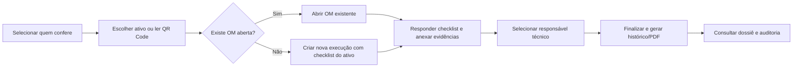

# Manutenção em Campo

[](https://github.com/Mayconxzdev/ManutencaoEmCampo/actions/workflows/ci.yml)


> Aplicação de gestão de manutenção industrial para uso em campo, com checklists digitais, evidências, histórico, geração de PDF e interface responsiva para computador, tablet e celular.

**Autor:** [Maycon Ferreira](https://github.com/Mayconxzdev) · **Idioma:** Português do Brasil · **Status:** versão pública funcional

> [!IMPORTANT]
> Todos os dados, pessoas, ativos, fabricantes, ordens, fotos e cenários deste repositório são **fictícios**. Não há conexão com empresa, servidor, NAS, banco, documento ou infraestrutura externa.

## Origem do projeto

Desenvolvi esta versão pública a partir de jornadas e necessidades que observei no sistema privado **Vesper Manutenção**. Reconstruí o fluxo com pessoas, ativos, ordens e evidências totalmente fictícios, sem copiar documentos, banco, credenciais, endereços ou registros operacionais da empresa.

## Problema que trabalhei

Equipes de manutenção precisam registrar a execução sem depender de papel, sem perder o histórico anterior e sem transformar o trabalho em campo em uma tarefa burocrática. Por isso, cada execução mantém contexto, pessoa responsável pela conferência, responsável técnico, checklist versionado, evidências e trilha de eventos.

A ideia principal é preservar a **rastreabilidade da decisão** e facilitar a consulta posterior.

## Visão geral

| Área | Como foi implementada |
|---|---|
| Operação de campo | Interface responsiva, PWA, scanner QR e checklist orientado por etapa |
| Rastreabilidade | Ordem de manutenção, responsáveis distintos, eventos, respostas, anexos e PDF final |
| Domínio | Ativos, setores, planos, modelos versionados, OMs, ocorrências, materiais e evidências |
| Robustez | SQLite transacional, IDs opacos, hashes, fila de dossiês, backups e validações de integridade |
| Experiência de uso | Seleção simples de pessoa, avisos não bloqueantes e mensagens em linguagem operacional |
| Engenharia | FastAPI, SQLAlchemy assíncrono, React, TypeScript, PWA, testes, lint e CI |

## Fluxo principal



Uma execução anterior nunca é sobrescrita. Ao iniciar novamente um ativo já registrado, o sistema mostra o histórico como contexto e cria uma nova ordem com o checklist correspondente.

## Interface

| Painel operacional | Ativos identificados |
|---|---|
|  |  |

| Checklist por ativo | Histórico, responsáveis e evidências |
|---|---|
|  |  |

## Arquitetura

```text
React + TypeScript + Vite/PWA
             │ HTTP/JSON
             ▼
FastAPI + SQLAlchemy assíncrono
             │
             ▼
SQLite local demonstrativo
             │
             ├── evidências e relatórios locais
             ├── hashes e eventos de auditoria
             └── dossiês por ativo/ordem
```

O banco é local por padrão para facilitar a execução e permitir uso offline. Uma implantação real pode usar armazenamento externo por variáveis de ambiente; a cópia pública não contém URL, IP, credencial ou conexão externa embutida.

Detalhes: [arquitetura](docs/arquitetura.md) · [decisões técnicas](docs/decisoes-tecnicas.md) · [privacidade](docs/privacidade-e-dados-demo.md) · [origem da versão pública](docs/origem-publica.md).

## O que desenvolvi

- seleção de pessoa responsável pela conferência;
- identificação de ativos por lista ou QR Code;
- checklists específicos por ativo e modelos versionados;
- ordens de manutenção com eventos, materiais, anexos e responsáveis;
- preservação do histórico sem sobrescrever execuções anteriores;
- geração de PDF e dossiê por ativo/ordem;
- hashes para arquivos e trilha de eventos;
- PWA responsiva para computador, tablet e celular;
- testes de backend, lint, build e fluxos de navegador.

## Executar localmente

### Backend

```powershell
python -m venv .venv
.\.venv\Scripts\Activate.ps1
python -m pip install -r backend\requirements-core.txt
cd backend
python scripts\seed_demo.py --reset
uvicorn app.main:app --reload --port 8000
```

### Interface

Em outro terminal:

```powershell
cd frontend
npm install
npm run dev
```

Abra `http://localhost:5173`. A API estará em `http://localhost:8000`.

O script `seed_demo.py` cria quatro ativos, quatro pessoas, quatro planos e quatro OMs fictícias. Ele só recria o banco localizado na pasta `data/` do próprio repositório.

## Validar

```powershell
npm run validate
npm run test:browser
```

Também é possível executar `npm run test:backend`, `npm run lint` e `npm run build` separadamente. O GitHub Actions executa testes da base demonstrativa, lint e build a cada push e pull request.

## Decisões técnicas

- **Dados isolados:** a versão pública usa seed explícito e dados descartáveis.
- **Histórico preservado:** uma nova execução cria uma nova OM; registros anteriores continuam consultáveis.
- **Checklist por ativo:** o sistema não usa silenciosamente um modelo genérico quando existe um modelo específico.
- **Responsabilidades separadas:** quem confere pode ser diferente de quem executa a manutenção.
- **Arquivos e transações separados:** anexos recebem hash e o SQLite preserva a transação e a trilha de eventos.
- **PWA com limites claros:** consultas seguras usam cache; concluir, anexar e sincronizar dependem de conexão.

## Estado e limites

Esta versão apresenta arquitetura e fluxos operacionais, mas não afirma certificação, aprovação normativa ou integração com ambiente empresarial. A seleção de pessoa serve apenas para rastreabilidade e não substitui autenticação ou controle de acesso.

Para uma implantação real, eu adicionaria autenticação adequada ao contexto, autorização por perfil e ativo, HTTPS, observabilidade centralizada, política de retenção, backup monitorado e revisão dos checklists por responsáveis técnicos.

## Roteiro de uso

1. Gere a base sintética com `python scripts\seed_demo.py --reset` dentro de `backend`.
2. Abra a aplicação, escolha **Camila Duarte**, entre em **Iniciar Checklist Digital** e selecione um ativo.
3. Observe o aviso de execução anterior e crie uma nova OM sem apagar a anterior.
4. Conclua os itens, selecione quem executou a manutenção e finalize.
5. Consulte o PDF e o dossiê em `data\dossies`.

O seed já contém uma execução concluída pelo mesmo fluxo da aplicação: itens respondidos, foto sintética, PDF com hash e dossiê local.

## Licença

Distribuído sob a licença [MIT](LICENSE). Veja também [SECURITY.md](SECURITY.md) e [CONTRIBUTING.md](CONTRIBUTING.md).
