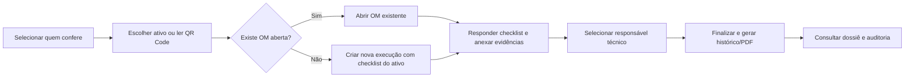
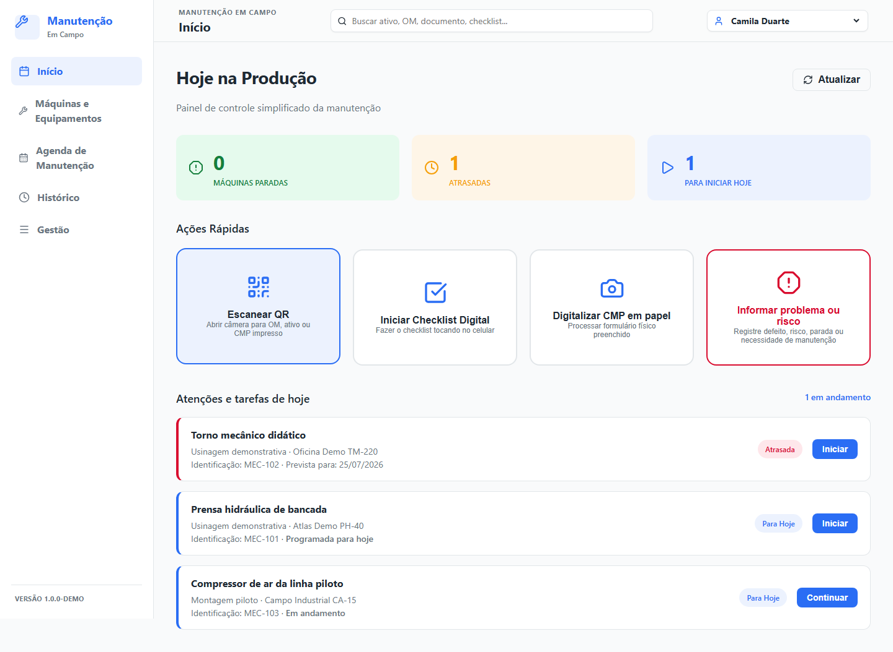
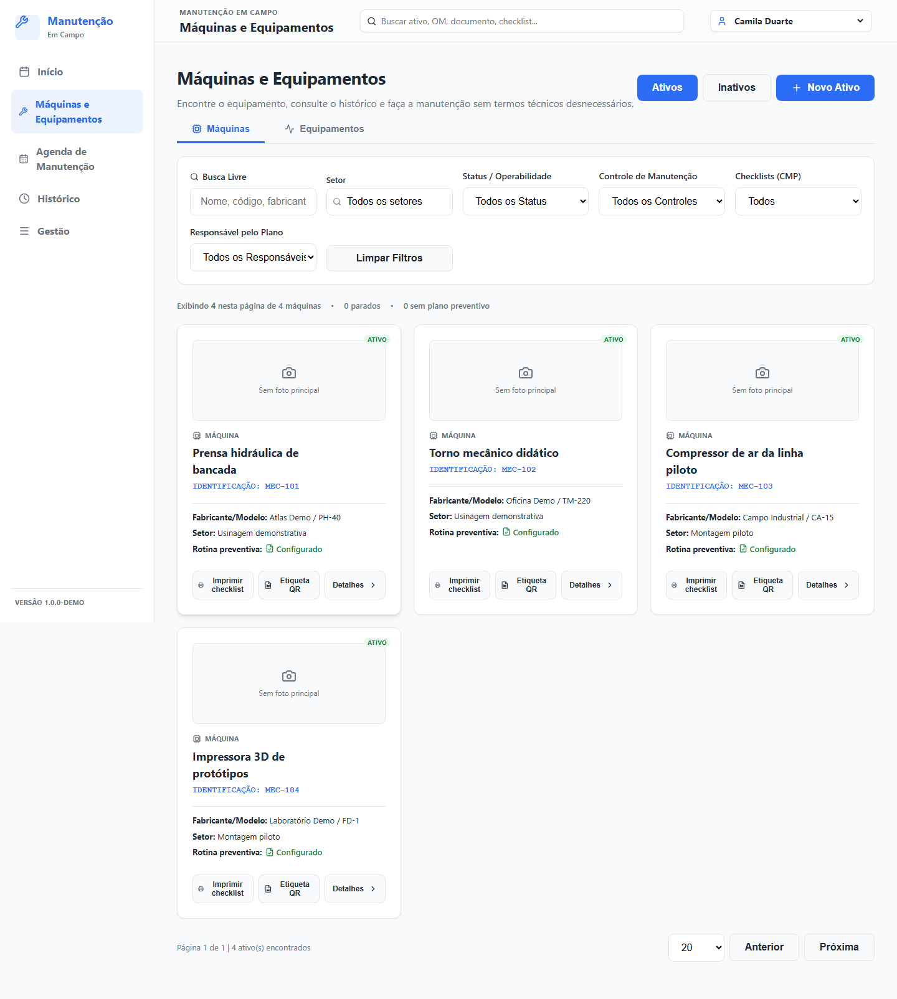
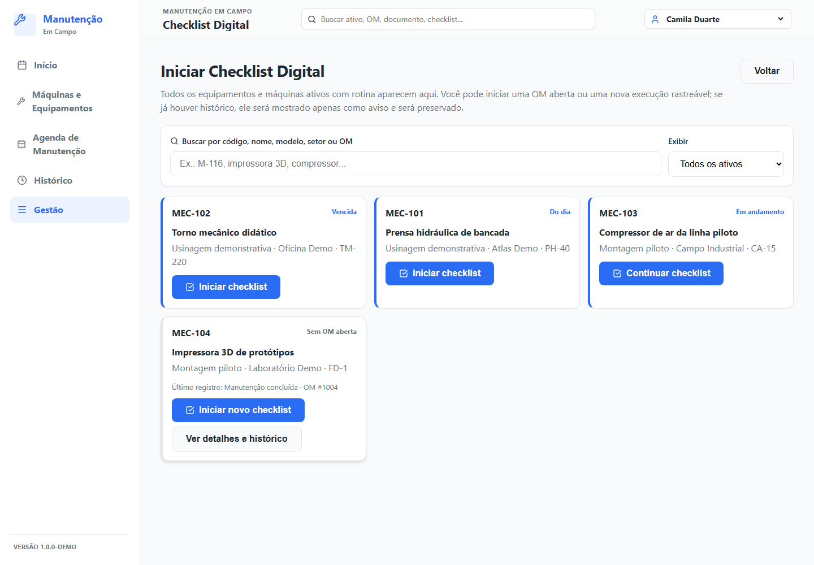
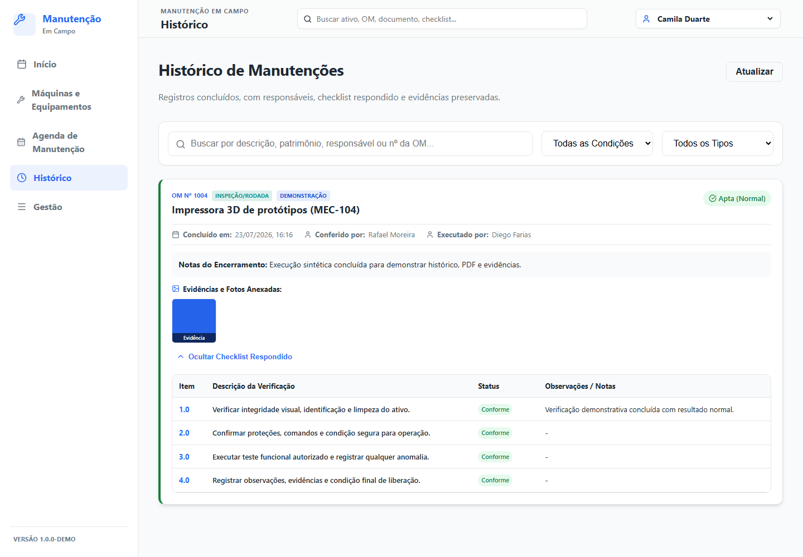

# Manutenção em Campo

[](https://github.com/Mayconxzdev/ManutencaoEmCampo/actions/workflows/ci.yml)


> Demonstração pública de uma aplicação de gestão de manutenção industrial, concebida para operação em campo com rastreabilidade de execução, checklists digitais, evidências, geração de PDF e experiência responsiva para computador, tablet e celular.

**Autor:** [Maycon Ferreira](https://github.com/Mayconxzdev) · **Idioma:** Português do Brasil · **Status:** projeto de portfólio funcional

> [!IMPORTANT]
> Todos os dados, pessoas, ativos, fabricantes, ordens, fotos e cenários deste repositório são **fictícios**. Não há conexão com empresa, servidor, NAS, banco, documento ou infraestrutura externa.

### Origem do case

Esta demonstração pública foi derivada de padrões, jornadas e necessidades observados no sistema privado **Vesper Manutenção**.

O projeto público foi reconstruído com dados, pessoas, ativos, ordens e evidências totalmente fictícios. Nenhum documento, banco, credencial, endereço, infraestrutura ou registro operacional da empresa foi copiado para este repositório.

## Por que este projeto existe

Equipes de manutenção precisam registrar a execução sem depender de papel, sem perder o histórico anterior e sem transformar o uso em campo em uma tarefa burocrática. O projeto explora esse problema como produto e como sistema: cada execução possui contexto, responsável pela conferência, responsável técnico, checklist versionado, evidências e trilha de eventos.

O foco não é apenas “marcar itens como concluídos”; é preservar a **rastreabilidade da decisão** e tornar essa informação fácil de localizar depois.

## Visão rápida

| O que demonstra | Como foi tratado |
|---|---|
| Operação de campo | Interface responsiva, PWA, scanner QR e fluxo de checklist orientado por etapa |
| Rastreabilidade | Ordem de manutenção, responsáveis distintos, eventos, itens respondidos, anexos e PDF final |
| Modelagem de domínio | Ativos, setores, planos, modelos versionados, OMs, ocorrências, materiais e evidências |
| Robustez | SQLite transacional, IDs opacos, hashes, fila de dossiês, backups e validações de integridade |
| Experiência de uso | Seleção simples de pessoa, avisos não bloqueantes e mensagens em linguagem operacional |
| Engenharia | FastAPI, SQLAlchemy assíncrono, React, TypeScript, PWA, testes, lint e CI |

## Fluxo principal



Uma execução anterior é sempre preservada. Ao iniciar novamente um ativo já registrado, o sistema apresenta o histórico como contexto e permite continuar, gerando uma nova ordem com o checklist vinculado ao ativo.

## Demonstração visual

As imagens abaixo são capturadas da base demonstrativa incluída neste repositório.

| Painel operacional | Ativos identificados |
|---|---|
|  |  |

| Checklist por ativo | Histórico, responsáveis e evidências |
|---|---|
|  |  |

## Arquitetura

```text
React + TypeScript + Vite/PWA
             │ HTTP/JSON
             ▼
FastAPI + SQLAlchemy assíncrono
             │
             ▼
SQLite local demonstrativo
             │
             ├── evidências e relatórios locais
             ├── hashes e eventos de auditoria
             └── dossiês por ativo/ordem
```

O banco é local por padrão para simplificar a execução da demo e permitir operação offline. Uma implantação real pode configurar armazenamento externo explicitamente por variáveis de ambiente; a cópia pública não possui URL, IP, credencial ou conexão externa embutida.

Detalhes: [arquitetura](docs/arquitetura.md) · [decisões técnicas](docs/decisoes-tecnicas.md) · [privacidade da demonstração](docs/privacidade-e-dados-demo.md) · [origem e escopo da cópia pública](docs/origem-publica.md).

## Executar localmente

### Pré-requisitos

- Python 3.11 ou 3.12;
- Node.js 22 LTS ou superior;
- npm.

### 1. Backend e dados fictícios

```powershell
python -m venv .venv
.\.venv\Scripts\Activate.ps1
python -m pip install -r backend\requirements-core.txt
cd backend
python scripts\seed_demo.py --reset
uvicorn app.main:app --reload --port 8000
```

### 2. Interface

Em outro terminal:

```powershell
cd frontend
npm install
npm run dev
```

Abra `http://localhost:5173`. A API estará em `http://localhost:8000`.

O script `seed_demo.py` cria quatro ativos, quatro pessoas, quatro planos e quatro OMs fictícias. Ele só permite recriar banco localizado na pasta `data/` do próprio repositório.

## Validar o projeto

```powershell
# Com o ambiente virtual do passo 1 ainda ativado:
# Da raiz do repositório: uma sequência curta para revisão técnica
npm run validate

# Fluxos de tela em desktop, tablet e celular, sempre com base isolada
npm run test:browser
```

Também é possível rodar cada etapa isoladamente com `npm run test:backend`, `npm run lint` e `npm run build`. O GitHub Actions executa o teste da base demonstrativa, lint e build a cada push e pull request. Os fluxos de navegador são reprodutíveis localmente por `npm run test:browser`: sobem uma instância isolada e descartável e percorrem desktop, tablet e celular. O Playwright é uma dependência opcional para que a qualidade estática não fique bloqueada em runners corporativos com proxy restrito.

## Decisões de engenharia que valem conhecer

- **Sem dados corporativos no repositório:** a demo usa seed explícito e dados descartáveis.
- **Rastreabilidade não é sobrescrita:** nova execução cria nova OM; registros anteriores continuam consultáveis.
- **Checklist específico por ativo:** o sistema não usa um modelo genérico silenciosamente quando o ativo exige modelo próprio.
- **Responsabilidades separadas:** quem confere no tablet pode ser diferente de quem executa a manutenção.
- **Evidência e dados transacionais separados:** arquivos são tratados como anexos versionados por hash; o SQLite preserva a transação e a trilha de eventos.
- **PWA com limites honestos:** consultas seguras recebem estratégia de cache; concluir, anexar e sincronizar dependem de conexão e ficam explícitos para quem opera.

Leia a motivação e os trade-offs em [docs/decisoes-tecnicas.md](docs/decisoes-tecnicas.md).

## Escopo e limites desta demonstração

O repositório demonstra arquitetura e fluxos operacionais; ele não afirma certificação, aprovação normativa nem integração com ambiente empresarial. A seleção de pessoa nesta demo serve exclusivamente para **rastreabilidade** e não é autenticação nem controle de acesso. Para produção, eu adicionaria autenticação adequada ao contexto, autorização por perfil e por ativo, HTTPS, observabilidade centralizada, política de retenção, infraestrutura de backup monitorada e revisão dos checklists por responsáveis técnicos.

## Como avaliar sem depender de dados reais

1. Gere a base sintética com `python scripts\seed_demo.py --reset` dentro de `backend`.
2. Abra a aplicação, escolha **Camila Duarte**, entre em **Iniciar Checklist Digital** e selecione um ativo.
3. Veja o aviso de execução anterior: ele informa data, quem conferiu e quem executou, mas permite criar uma nova OM sem apagar a anterior.
4. Conclua os itens, selecione quem executou a manutenção e finalize. O sistema gera o PDF e deixa o dossiê local em `data\dossies` — tudo recriável e ignorado pelo Git.

O seed já contém uma execução demonstrativa concluída pelo mesmo caminho de produção: itens respondidos, foto sintética, PDF com hash e dossiê local. A imagem de histórico acima é capturada dessa base isolada. Para recriar as imagens depois de uma alteração visual, rode `npm run docs:screenshots` dentro de `frontend`.

## Licença

Distribuído sob a licença [MIT](LICENSE). Veja também [SECURITY.md](SECURITY.md) e [CONTRIBUTING.md](CONTRIBUTING.md).
