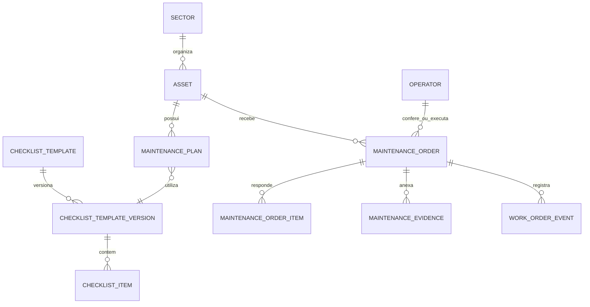

# Arquitetura

## Contexto

Manutenção em Campo é uma demonstração pública de um sistema de manutenção orientado por ativos. O desenho prioriza leitura simples no tablet, preservação de histórico e execução local reproduzível.

## Componentes

| Camada | Tecnologia | Responsabilidade |
|---|---|---|
| Interface | React, TypeScript, Vite, PWA | Fluxos de checklist, inventário, agenda, histórico e uso em campo |
| API | FastAPI | Regras de negócio, serialização, validação e rotas HTTP |
| Persistência | SQLAlchemy assíncrono + SQLite | Consistência transacional de ativos, planos, OMs e auditoria |
| Documentos | Sistema de arquivos local | Evidências, PDFs, backups e dossiês demonstrativos |
| Qualidade | Pytest, oxlint, TypeScript, GitHub Actions | Regressão, build e padronização |

## Entidades centrais

## Princípios

1. **Histórico é aditivo.** Finalizar uma nova manutenção não modifica o registro anterior.
2. **Modelo é explícito.** A execução aponta para a versão de checklist usada naquele momento.
3. **Arquivos não substituem dados.** A evidência complementa a ordem; ela não é a fonte transacional.
4. **Demo isolada.** A configuração padrão usa `data/` local e nunca conhece redes externas.
5. **Portabilidade.** A aplicação pode iniciar com banco recriável por script, sem dependência de serviços gerenciados.

## Fluxo de dados de uma execução

1. A pessoa selecionada inicia ou abre uma OM.
2. O backend salva o contexto de quem conferiu e cria itens a partir da versão vinculada ao plano.
3. Respostas, observações e evidências são persistidas individualmente.
4. A finalização registra responsável técnico, condição final, eventos e artefatos gerados.
5. O histórico expõe o registro sem depender da tela operacional atual.

## Fronteiras de produção

Esta demonstração não implementa uma política corporativa de identidade. Em uma implantação real, a camada de autorização deve ser adicionada por dependências de rota, com escopo por unidade/ativo e proteção para operações de escrita. CORS, HTTPS e armazenamento externo devem ser configurados no ambiente de implantação, não codificados no repositório.
